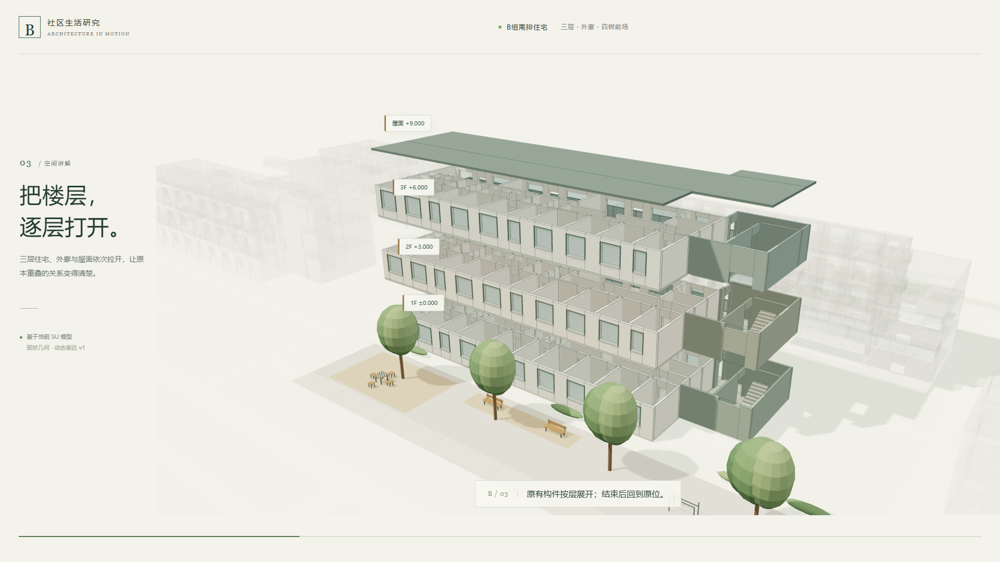

# 建筑模型解析与交互推导

读取建筑模型与资料，组织有依据的空间讲解、人物活动流线和连续镜头，生成可离线打开的三维交互网页。

**[在线体验](https://kakaluote1014.github.io/architectural-model-derivation/)** · **[B组交互案例](https://kakaluote1014.github.io/architectural-model-derivation/bgroup/)** · **[下载离线HTML](https://kakaluote1014.github.io/architectural-model-derivation/bgroup/offline.html)** · **[下载Skill](https://kakaluote1014.github.io/architectural-model-derivation/downloads/architectural-model-derivation-v0.1.1.zip)**

[](https://kakaluote1014.github.io/architectural-model-derivation/bgroup/)

## 演示：从家门，到树下

首页采用B组南排原版48秒交互网页作为**方法来源案例**：社区定位、四树前场、分层展开、代表户型、外廊与楼梯、整体归位。保留原有视觉和镜头，公开副本修正了楼梯侧门及地面绕行路径、清理本机路径，并补齐第三方许可。

案例来自历史r13工作模型的既有导出数据，含270,817个三角形。交通片段按48秒叙事压缩时间，人物是尺度与走行示意，不代表实际步速或真实行为记录。本次没有新的SketchUp原生提取，也不把该历史成品宣称为当前Skill一键生成的结果。控制矩形不是完成面净面积，显示板带不证明承重结构。

网页可以播放/暂停、跳章、拖动时间轴、自由旋转缩放、展开楼层、打开屋面、查看交通和功能，并在同一几何与相机下切换白模。默认静音；历史AI旁白视频未发布。

## Skill v0.1.1

可加载目录：[architectural-model-derivation](architectural-model-derivation/SKILL.md)。核心接收米制Y向上的三角网格JSON，输出单文件离线HTML和可编辑源码。

- 解析现有模型的构成与空间；功能、楼层和代表空间按当前输入确认或配置。
- 配置人物行走、上下楼、交流、坐下停留及活动流线；建筑、相机、人物姿态和路径共用确定性时间轴。
- 人物与流线独立显隐、活动选择、桌面和手机交互；无资料时保持轻量入口，相应控制禁用。
- 过程还原和备选推演已有方法边界，尚无自动历史还原或改模比较实现。成品模型的解释不是设计者真实经历的设计过程。

详细输入：[输入与运行](architectural-model-derivation/references/input.md) · [人物活动](architectural-model-derivation/references/activities.md) · [验收范围](architectural-model-derivation/references/verification.md)

## 本地试跑

需要Node.js 18+和支持WebGL的浏览器。构建和路径采样只使用标准库与已随包保留许可的Three.js，不自动安装软件。

```sh
node architectural-model-derivation/scripts/model_web.mjs inspect --model examples/synthetic/mesh.json
node architectural-model-derivation/scripts/check_routes.mjs --model examples/synthetic/mesh.json --config examples/synthetic/project.json --out output-route-checks.json
node architectural-model-derivation/scripts/model_web.mjs build --model examples/synthetic/mesh.json --config examples/synthetic/project.json --out output
```

双击 `output/index.html`。输出目录必须不存在，防止覆盖。独立两层L形数据含已知测试楼梯和座椅，**仅用于测试软件迁移，不是建筑设计或合规示例**。

浏览器QA另需本机已有Playwright和Chrome/Edge：

```sh
node architectural-model-derivation/scripts/qa_browser.cjs --dir output --browser /path/to/browser --playwright /path/to/playwright
node tests/public-demo.cjs --url https://kakaluote1014.github.io/architectural-model-derivation/bgroup/ --out local-qa --browser /path/to/browser --playwright /path/to/playwright
```

## 实现与验证边界

v0.1.1本地B组活动版通过67项浏览器检查，独立两层活动测试通过66项；这些结果属于对应本地输入与版本。公开首页历史案例另有发布前及上线浏览器检查，见 [公开案例验收](docs/verification.json)。路径采样不是连续人体碰撞、完整动作接触、专业人流或消防/无障碍/结构验算。实体手机和新的原生模型提取未验证。

仓库仅发布Skill核心、公开演示副本和合成测试数据，不包含原生SKP、私有工作目录、语音、视频或历史工作缓存。

## 来源与许可

本仓库**没有统一声明为MIT**。Skill核心与历史展示案例的来源分开：核心不依赖motion.js；历史案例含motion.js（PolyForm Noncommercial 1.0.0）。Three.js为MIT，保留原许可。模型与设计资料不因第三方库许可而获得其他授权。详情见 [LICENSE.md](LICENSE.md) 与 [案例声明](docs/bgroup/THIRD_PARTY_NOTICES.txt)。
